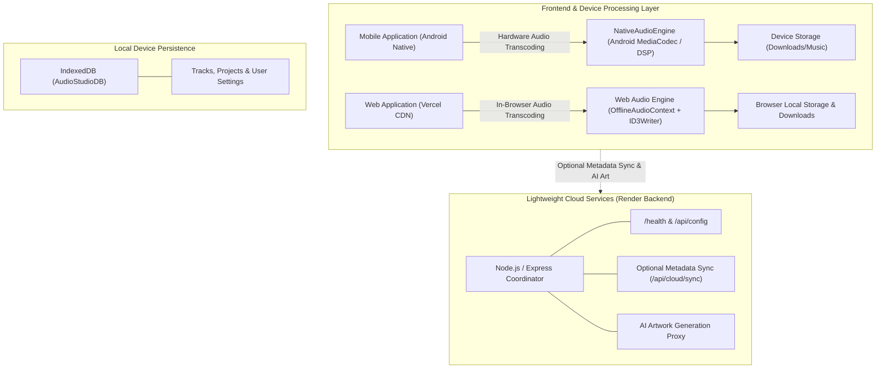

# Audio Studio — Professional Device-Powered Audio Workstation

Audio Studio is a modern, high-performance audio editing, compression, metadata tagging, and analysis workstation designed with a **Device-First, Hardware-Accelerated Architecture**.

> **Important Architecture Principle**: The user's mobile device or desktop browser performs 100% of the actual audio processing (decoding, resampling, compression, trimming, tagging, waveform analysis, and packaging) locally using native CPU/DSP hardware capabilities. Audio files are never sent to remote cloud servers for core operations.

---

## 🏛️ System Architecture



---

## 📱 Mobile Device Processing (Android)

The Android application operates completely **offline** with zero reliance on cloud computing:

- **Hardware Acceleration**: Built with a dedicated native Android bridge plugin (`NativeAudioEngine.java` + `AudioTranscoder.java`).
- **MediaCodec & MediaMuxer**: Audio tracks (MP3, M4A, AAC, WAV, FLAC, OGG) are decoded via Android's native multimedia framework into PCM audio and re-encoded using hardware AAC/MPEG-4 encoders.
- **Dynamic Bitrate Scaling**: User-selected target bitrates (320k, 256k, 192k, 160k, 128k, 96k, or custom).
- **Metadata Retraction & Embedding**: Native `MediaMetadataRetriever` extracts tags and embedded album art.
- **Scoped Storage Compliant**: Exports directly into public `Downloads/AudioStudio` and launches the native Android Share sheet.

---

## 🌐 Web Processing (Vercel Web App)

When running in modern desktop and mobile browsers:

- **Web Audio API**: Decodes and resamples audio locally via `AudioContext` and `OfflineAudioContext`.
- **Client-Side ID3v2 Tagging**: Uses `browser-id3-writer` to embed Title, Artist, Album, Year, Genre, Track Number, Lyrics, and Cover Artwork directly into MP3 files in client memory.
- **Local ZIP Packaging**: Uses `JSZip` to bundle batch jobs into a compressed archive on the client without uploading bytes to any server.

---

## 🚀 Key Modules & Capabilities

### 1. Audio Compressor
- **Bitrate Presets**:
  - `320 kbps` (Studio Master — Near transparent)
  - `256 kbps` (High Fidelity — Audiophile balance)
  - `192 kbps` (Broadcast Standard — High quality)
  - `160 kbps` (Balanced — Modern streaming)
  - `128 kbps` (Small File — Rapid sharing)
  - `96 kbps` (Podcast / Voice — Ultra compact)
- **Controls**: Custom bitrate slider, sample-rate conversion (48kHz, 44.1kHz, 32kHz, 22.05kHz), channel conversion (Stereo / Mono), format selection.
- **Batch Processing**: Multi-track queue, real hardware progress callbacks, cancel/retry, and local ZIP archive export.
- **A/B Audio Comparison**: Real-time before-and-after A/B switcher allowing live auditioning between original and compressed audio.

### 2. MetaTune (Tag & Artwork Editor)
- **Tag Fields**: Title, Artist, Album, Album Artist, Genre, Year, Track Number, Composer, Copyright, Lyrics.
- **Artwork Studio**: Add, preview, remove, or replace cover art.
- **AI Cover Art Generator**: Generates 4K album artwork prompts with style and mood parameters via Pollinations AI.
- **Direct Tag Writing**: Writes genuine ID3v2.3 tags directly into MP3s.

### 3. Audio Tools & Analyzer
- **Loudness & Levels**: Integrated LUFS estimation, True Peak dBFS, RMS level, Dynamic Range.
- **Integrity Inspection**: Clipping sample counter and silence interval detection (< -50 dBFS).
- **Multi-band Spectrum**: Sub-bass, Bass, Low-Mid, Mid, High-Mid, High frequency energy meters.
- **Local Audio Trimmer**: Non-destructive start/end boundary selection with local export.

### 4. Device Music Library
- **Offline Indexing**: Local IndexedDB database storing imported and processed tracks.
- **Management**: Search by title/artist/album, filter by favorites/processed, sort by date/size/title.
- **Integrated Player**: Scrubber, timestamp readout, volume, speed control (0.75x to 2x), and loop.

---

## 🛠️ Local Development & Build

### Prerequisites
- Node.js 20+
- Java 21+ & Android SDK (for Android APK builds)
- Python 3.10+ (for optional MetaTune service)

### Install & Run Locally
```bash
# Install dependencies
npm install

# Start Vite frontend and backend coordinator concurrently
npm run dev
```

### Run Tests
```bash
# Run Vitest test suites (audioEngine, projectCompletion, server routes, utils)
npm test

# Run real audio file processing test (metatune/test.mp3 tagging & zip export)
npm run verify:audio

# Run Python MetaTune unit tests (12 tests)
cmd /c "set PYTHONPATH=metatune&& .\.venv\Scripts\python.exe -m unittest discover -s metatune/tests"
```

---

## 📦 Deployment Guides

### 1. Vercel (Frontend SPA)
The frontend builds into `dist/client` and routes all pages through `vercel.json`:
- **Build Command**: `npm run build:client`
- **Output Directory**: `dist/client`
- **SPA Rewrites**: Configured in `vercel.json` to handle all client routes (`/`, `/compressor`, `/metatune`, `/library`, `/tools`, `/settings`).

### 2. Render (Lightweight Cloud Coordinator)
The backend runs as a lightweight service defined in `render.yaml`:
- **Build Command**: `npm ci --include=dev && (python3 -m venv .venv && .venv/bin/pip install -r metatune/requirements.txt || true) && npm run build`
- **Start Command**: `npm start`
- **Health Check**: `/health` (Responds in milliseconds with `{ ok: true, version: "2.0.0", mode: "device-first" }`)
- **CORS**: Fully enabled for all origins including Vercel.

### 3. Android APK Build
Build the standalone offline APK:
```bash
npm run android:apk
```
The compiled release APK is generated at:
`android/app/build/outputs/apk/debug/app-debug.apk` and mirrored to `artifacts/Audio-Studio-Release.apk`.
