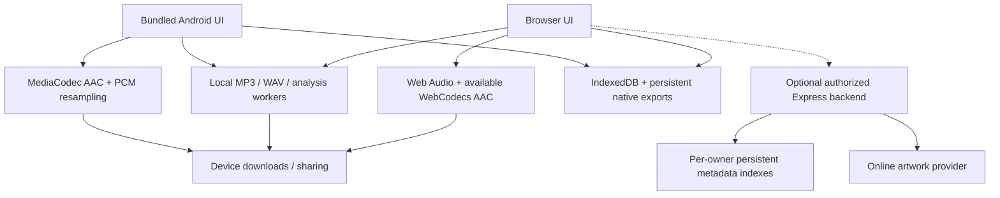

# Audio Studio — Device-Powered Audio Workstation

[](https://github.com/durveshk01/Audio-Studio/actions/workflows/ci.yml)
[](https://audio-studio-eosin.vercel.app)
[](https://github.com/durveshk01/Audio-Studio/releases/tag/v2.1.0)
[](https://github.com/durveshk01/Audio-Studio/releases/download/v2.1.0/Audio-Studio-Release.apk)

Audio Studio provides local audio compression, MP3/M4A tagging, cover design, analysis, trimming, playback, and a persistent music library.

- **Android:** bundled offline application; core operations use the phone's CPU and Android media codecs. The signed release has no Internet permission.
- **Web:** audio processing runs in the browser. An optional, explicitly configured backend supports metadata-index uploads and online artwork generation.

## Download

- [Android APK — v2.1.0](https://github.com/durveshk01/Audio-Studio/releases/download/v2.1.0/Audio-Studio-Release.apk)
- [APK SHA-256 checksum](https://github.com/durveshk01/Audio-Studio/releases/download/v2.1.0/Audio-Studio-Release.apk.sha256)
- [Release notes and verification evidence](https://github.com/durveshk01/Audio-Studio/releases/tag/v2.1.0)
- [Open the web studio](https://audio-studio-eosin.vercel.app)

Android requires **Android 7.0 / API 24+** and **Android System WebView 99+**. Codec availability and hardware acceleration depend on the device; Settings reports the selected engine and available output formats. Keep WebView updated before using the app offline.

## Features

### Audio compressor

- Genuine MP3, AAC in an M4A container, and 16-bit PCM WAV outputs.
- Bitrates: 64, 96, 128, 160, 192, 224, 256, and 320 kbps. MP3 at 22,050 Hz supports up to 160 kbps; WAV bitrate follows its sample rate and channel count.
- Sample rates: 22,050, 32,000, 44,100, and 48,000 Hz; mono or stereo.
- Batch queue, progress, cancellation/retry, persistent exports, native sharing, and ZIP files containing actual audio bytes.
- A/B playback and measured output sizes/bitrates, including outputs larger than the source.

On Android, `NativeAudioEngine` uses MediaExtractor, MediaCodec, MediaMuxer, and streaming PCM resampling for M4A. MP3 and WAV use bundled worker encoders. Browser AAC is offered when WebCodecs supports it. Input decoding depends on the platform's support for MP3, M4A, AAC, WAV, FLAC, and OGG.

### MetaTune and cover artwork

- Read and write MP3 ID3 and standard M4A tags without re-encoding audio or changing its container.
- Title, artist, album, album artist, genre, year/date, track number, composer, and plain lyrics.
- Preserve existing artwork, replace it with a JPEG/PNG, or remove it.
- Create a **1024 × 1024 PNG** locally using gradient, vinyl, or minimal styles.
- Prepared exports remain available when library storage or the system save operation fails.

### Analysis and trimming

- K-weighted gated integrated loudness, RMS, sample peaks, crest factor, near-full-scale sample count, and measured silence intervals.
- Hann-windowed FFT frequency-band energy and a peak envelope.
- A 4× windowed-sinc intersample peak estimate; this is not a certified true-peak meter.
- Trim a selected region and export it as WAV, MP3, or available AAC/M4A.

### Library and preferences

- IndexedDB stores imported audio, processed tracks, tags, artwork, favorites, and preferences.
- Android native exports use persistent private storage and survive temporary-cache cleanup.
- Search, sorting, favorites, playback, seeking, loop, volume, and speed control.
- Dark/light themes, reduced motion, saved encoder/bitrate defaults, and engine diagnostics.
- Android 10+ saves to `Downloads/AudioStudio`; Android 7–9 uses the system document picker. Sharing uses a narrowly scoped FileProvider.

### Working limits

- 100 MB per input; up to 100 queued tracks.
- Browser/worker decoded PCM limit: 128 MB. Native M4A conversion streams PCM and can process tracks beyond that decoded-memory limit.
- ZIP/in-memory device export limit: 200 MB; library import batches are also bounded to 200 MB.
- Artwork: JPEG/PNG up to 8 MB. Unsupported, oversized, or corrupt inputs produce an error.

## Architecture



The optional Express/FFmpeg and FastAPI/Mutagen services preserve legacy workflows. They are separate from the APK's local processing path.

## Development

### Requirements

- Node.js **22.12+**; Node 24 is used in CI.
- Android builds: **JDK 21**, Android SDK platform 36 and build-tools 36.0.0+, plus platform-tools.
- Python 3.10+ for the optional MetaTune service/tests.
- FFmpeg/ffprobe for optional server compression and native test-fixture generation.

```bash
npm ci
npm run dev
```

### Checks

```bash
npm test
npm run typecheck
npm run lint
npm run verify:audio
npm run verify:ffmpeg
npm run build
npm run test:e2e
```

Install Chromium once with `npx playwright install chromium` before running `npm run test:e2e`. The browser suite builds the application and checks desktop and mobile routes, compression, metadata/artwork exports, trimming, and library persistence.

Python tests on Windows PowerShell:

```powershell
$env:PYTHONPATH="metatune"
& ".\.venv\Scripts\python.exe" -m unittest discover -s "metatune/tests"
```

On Linux/macOS, use `PYTHONPATH=metatune python -m unittest discover -s metatune/tests` after installing `metatune/requirements.txt`.

### Android release

Configure `ANDROID_HOME` and `JAVA_HOME`, or use `android/local.properties` for the SDK path. For the first production build, initialize signing and securely retain the ignored `.signing/` directory:

```bash
npm run android:signing
npm run android:apk
npm run android:test -- --serial DEVICE_SERIAL
```

Outputs:

- `artifacts/apk/Audio-Studio-Release.apk`
- `artifacts/apk/Audio-Studio-Release.apk.sha256`
- `artifacts/apk/Audio-Studio-Release.apk.build.json`
- `artifacts/android-tests/validation.json` after successful release instrumentation.

`android:apk` builds bundled Android-mode assets, checks native unit tests and release lint, aligns and signs the release, and verifies package/version, non-debuggable status, and offline permissions. `android:test` installs that release and a matching signed test APK, then exercises the packaged UI and native audio with real fixtures.

[Android signing, verification, and publishing details](docs/ANDROID_RELEASE.md).

## Deployment

### Web / Vercel

- Build: `npm run build:client`; output: `dist/client`.
- `vercel.json` routes the supported SPA pages. Production builds generate a local offline shell for subsequent visits.
- Optional backend URL: `VITE_BACKEND_URL` at build time, or the web Settings page.

### Optional Express / Render

- Build: `npm run build`; start: `npm start`; health: `/health`.
- `ALLOWED_ORIGINS` must include the actual frontend origin; CORS uses an allowlist.
- `API_TOKENS` maps owner IDs to distinct 32–256 character tokens. Web access tokens remain in memory for the session.
- `SYNC_STORAGE_DIR` must point to persistent storage to enable per-owner metadata-index sync. The index contains track descriptions, not audio backups.
- `POLLINATIONS_API_KEY` plus owner tokens enables optional online artwork generation.
- `ENABLE_METATUNE=true` explicitly starts the legacy Python service.
- FFmpeg uploads and jobs have request, queue, concurrency, and expiry limits. Remote processing requires backend authorization.

`render.yaml` provides a starting blueprint; configure origins, credentials, and persistent storage for the intended deployment.

## Verification

CI runs TypeScript/Vitest checks, lint, real ID3/ZIP and FFmpeg verification, Python tests, Android unit tests/lint, and release instrumentation on an Android 15 emulator. CI uses a disposable signing key; published APKs use the maintained release signing identity.

Release notes record the checks and Android versions actually tested. Emulator results establish those tested workflows; physical-device codec, audio-output, and OEM behavior require testing on the intended hardware.
